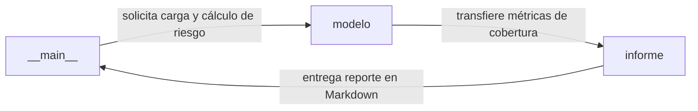

[Leer en español](README.md)

# Ley 1273 de 2009 frente a ISO/IEC 27001:2022

Audit tool mapping Colombian cybercrime legislation (Law 1273 of 2009) to ISO/IEC 27001:2022 controls and generating automated gap analysis reports.

[](https://github.com/ale0009/cumplimiento-ley-1273/actions/workflows/ci.yml)


## Why this exists

Assess and demonstrate whether organizational security controls effectively prevent and mitigate liability for cybercrime defined in the Colombian Penal Code.

## Architecture



### Components

| Component | Responsibility |
| --- | --- |
| `modelo` | Carga de CSV (delitos y controles ISO 27001), validación de listas de chequeo y cálculo de cobertura y nivel de riesgo. |
| `informe` | Generación del informe de auditoría y análisis de brechas en formato Markdown clasificando riesgos y priorizando controles pendientes. |
| `__main__` | CLI para visualizar la matriz delito-control, exportar plantillas CSV de autoevaluación y ejecutar auditorías de brechas. |

## Stack

- Python
- pytest
- uv

## Getting Started

### Installation

```bash
uv sync --dev
```

### Testing

```bash
uv run pytest -q
```

### Execution

```bash
uv run python -m cumplimiento_1273 matriz
```

## Results

| Metric | Value | Note |
| --- | --- | --- |
| Delitos en riesgo alto (caso ficticio) | 4 (269B, 269E, 269G, 269J) | Evaluación ficticia de empresa mediana en ejemplos/autoevaluacion_empresa_anonima.csv con cobertura inferior al 50 %. |
| Delitos en riesgo medio (caso ficticio) | 3 | Delitos evaluados con cobertura situada entre el 50 % y el 80 %. |
| Delitos en riesgo bajo (caso ficticio) | 2 | Delitos evaluados con cobertura igual o superior al 80 %. |
| Controles con mayor exposición de delitos | 8.15 y 8.16 (4 delitos cada uno), 8.5 (3 delitos) | Registro de eventos, monitoreo y autenticación segura señalados como brechas críticas a priorizar. |

## Limitations and Roadmap

### Limitations

- La correspondencia delito-control responde a un criterio técnico de auditoría y no constituye concepto ni asesoría jurídica formal.
- No incluye marcos normativos complementarios como la Ley 1581 de 2012 (protección de datos personales) ni la Ley 1266 de 2008 (habeas data).
- Mide la existencia declarada de controles pero no su eficacia operativa ni el respaldo probatorio de evidencias.

### Roadmap

- Incorporar controles de cumplimiento para la Ley 1581 de 2012 sobre protección de datos personales.
- Añadir soporte para asociar y validar referencias documentales de evidencias de auditoría.
- Exportar informes en formatos ejecutivos adicionales (HTML y PDF).

## Origin

Individual, open-source reimplementation based on an academic team project on ICT legal liability at Universidad ECCI.

## License

This project is licensed under the terms of the MIT license. See the LICENSE file for details.

Copyright (c) 2026 Mario Alejandro Puerta Alarcón.
