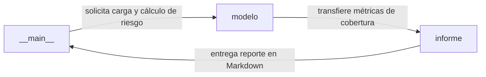

# Arquitectura del Sistema: Ley 1273 de 2009 frente a ISO/IEC 27001:2022

## Visión general

Herramienta de auditoría que correlaciona los delitos informáticos de la Ley 1273 de 2009 con los controles de ISO/IEC 27001:2022 y evalúa brechas de seguridad.

Evaluar y demostrar si los controles de seguridad de una organización previenen y mitigan la exposición a delitos informáticos tipificados en el Código Penal colombiano.

## Diagrama de arquitectura



## Componentes

| Componente | Responsabilidad |
| --- | --- |
| `modelo` | Carga de CSV (delitos y controles ISO 27001), validación de listas de chequeo y cálculo de cobertura y nivel de riesgo. |
| `informe` | Generación del informe de auditoría y análisis de brechas en formato Markdown clasificando riesgos y priorizando controles pendientes. |
| `__main__` | CLI para visualizar la matriz delito-control, exportar plantillas CSV de autoevaluación y ejecutar auditorías de brechas. |

## Flujo de datos

1. **__main__** comunica con **modelo**: solicita carga y cálculo de riesgo.
2. **modelo** comunica con **informe**: transfiere métricas de cobertura.
3. **informe** comunica con **__main__**: entrega reporte en Markdown.

## Registro de Decisiones de Arquitectura (ADR)

- [ADR-0001: Fórmula cuantitativa de cobertura ponderada y rangos de riesgo](adr/0001.md)
- [ADR-0002: Implementación sin dependencias externas en tiempo de ejecución](adr/0002.md)
- [ADR-0003: Empaquetado de datasets normativos con force-include en Hatchling](adr/0003.md)

## Calidad y pruebas

La verificación técnica del sistema se realiza de forma automatizada mediante la ejecución de:

```bash
uv run pytest -q
```
